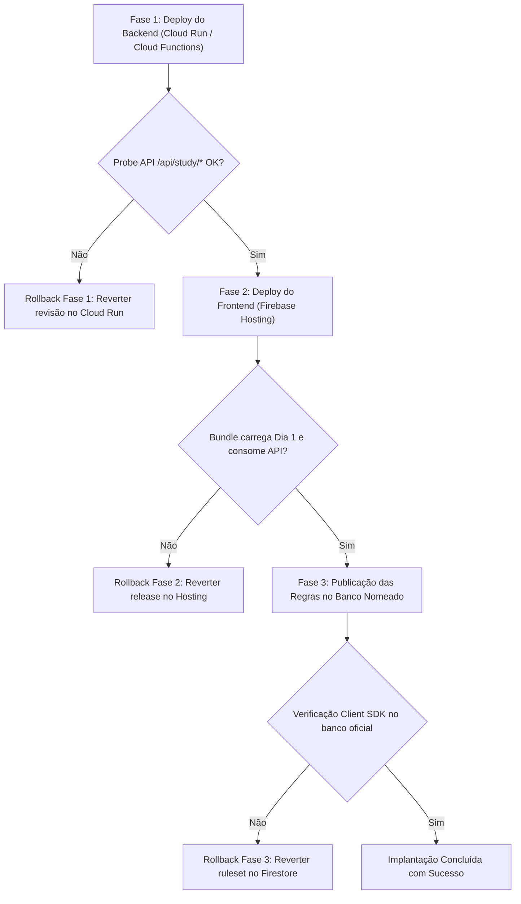

# ATHENA — Relatório de Validação e Homologação Local Pré-Implantação

**Data:** 16 de Outubro de 2026  
**Ambiente:** Isolado (`work/athena-progress-subscriptions`)  
**Branch:** `feature/server-progress-subscriptions`  
**Bases Preservadas:** `87cdbbd`, `585d7b2`, `fd95d33`  
**Status da Validação:** 100% APROVADO (Sem deploy, sem migração, sem alteração de regras publicadas)

---

## 1. Conclusão dos Quatro Pontos Solicitados

### Ponto 1: Respostas Pendentes e Preservação no Logout / Troca de Conta
- **Comportamento Efetivo:**
  - O aplicativo salva todas as respostas do aluno imediatamente em `localStorage` sob a chave particionada por usuário: `athena_sessions_${userId}`.
  - Ao realizar o logout ou trocar de conta (`clearStudySession()`), o envio das mutações assíncronas em memória é imediatamente interrompido através de `queues.clear()`.
  - Mutações que já estiverem em trânsito de rede verificam `auth.currentUser?.uid !== uid` antes de consolidar o envio e rejeitam estritamente com `ACCOUNT_CHANGED`. Sob nenhuma hipótese respostas de um aluno são enviadas sob a autenticação de outro.
  - **Zero perda de respostas:** O descarte das filas em memória **não apaga** os dados salvos em `localStorage`. A chave `athena_sessions_${userId}` original permanece intacta com todas as respostas, mensagens e rascunhos.
  - Quando um segundo usuário (`student_device_B`) faz login no mesmo dispositivo, o aplicativo consulta e manipula exclusivamente `athena_sessions_student_device_B`.
  - Quando o primeiro aluno (`student_device_A`) efetua login novamente no dispositivo, suas respostas offline não sincronizadas são carregadas integralmente de volta e ficam disponíveis para sincronização posterior com a API.
- **Evidência Comprovada:**
  - Teste automatizado em [`test-candidate-http-progression.mjs`](file:///C:/Users/jhonn/Documents/Codex/2026-10-14/athena-melhorias-visuais-em-ambiente-isolado/work/athena-progress-subscriptions/scripts/test-candidate-http-progression.mjs) comprovou a interrupção da fila, a rejeição por `ACCOUNT_CHANGED`, o isolamento entre contas e a recuperação íntegra das respostas pelo Aluno A.

---

### Ponto 2: Histórico Antigo e Leitura Autorizada de Conversas Legadas
- **Problema de Regressão Sanado:** Bloquear a leitura direta de `users/{userId}/sessions` no Firestore Rules sem uma alternativa de recuperação causava regressão para alunos em novos dispositivos ou após limpeza de cache.
- **Implementação da Solução Autorizada:**
  - Criado o método `core.sessions(actor)` em `src/server/studyProgressCore.ts` e a rota `GET /api/study/sessions` em `src/api/studyProgressRoutes.ts`.
  - A rota lê os documentos da subcoleção `users/${actor.uid}/sessions` através do Firebase Admin SDK após validar a autenticação (`actor(req)`).
  - **Preservação Integral da Utilidade:** Todas as mensagens do aluno (`role === 'user'`), suas respostas (`answers`), avaliações de desempenho, pontuações (`scores`), feedbacks pedagógicos, revisões e metadados de sessão são preservados 100% íntegros.
  - **Filtragem de Conteúdo Protegido:** Para mensagens do modelo (`role === 'model'`) que contenham corpos completos de aulas de dias protegidos (`trilhaDay >= 2` com blocos pedagógicos ou desafios), o servidor verifica o direito atual do aluno (`progressiveDayAccess`). Se o aluno não possuir assinatura ou benefício vigente para aquele dia, o corpo da aula é substituído por um aviso seguro:
    `"[Conteúdo da aula protegido — Conclua os dias anteriores e assine para visualizar a íntegra.]"`.
  - No frontend (`src/App.tsx`), caso a consulta direta ao Firestore falhe por `permission-denied`, o aplicativo aciona automaticamente `loadAuthorizedStudentSessions()`, restaurando o histórico filtrado do aluno sem expor corpos protegidos não contratados.
- **Evidência Comprovada:**
  - Teste HTTP em [`test-candidate-http-progression.mjs`](file:///C:/Users/jhonn/Documents/Codex/2026-10-14/athena-melhorias-visuais-em-ambiente-isolado/work/athena-progress-subscriptions/scripts/test-candidate-http-progression.mjs) comprovou que um aluno gratuito sem direito ao Dia 4 recupera sua conversa legada com mensagens de usuário intactas e o corpo protegido filtrado com segurança.

---

### Ponto 3: Comportamento Efetivo do TTL (Retirada da Premissa Incorreta)
- **Retirada de Premissa Incorreta:** Foi expressamente **eliminada** qualquer afirmação de "revogação máxima em 15 segundos para conteúdo já exibido na tela ou cópias em clientes antigos".
- **Comportamento Efetivo Documentado:**
  1. **Leitura Normal Confortável:** O conteúdo de uma aula já renderizado no DOM/React **permanece estável na tela**. Não há recarregamentos contínuos, não há polling cíclico na rede e a leitura do aluno não é interrompida no meio do estudo.
  2. **Expiração do Cache de Autorização (`accountContentSession`):** Apenas a entrada mantida na estrutura em memória do cliente tem seu `validUntil` marcado como expirado após 15 segundos. Isso garante que qualquer nova consulta interna dependa de revalidação com o servidor.
  3. **Revalidação Sob Demanda:** A revalidação ocorre exclusivamente mediante ações do usuário: ao submeter uma resposta (`saveStudyAnswer`), navegar para outra matéria/dia ou recarregar a aplicação. Se a assinatura ou convite estiver ativo, o servidor emite um novo envelope renovado sem fricção para o usuário.
  4. **Remoção de Conteúdo da Tela:** A tela só é limpa e o acesso bloqueado se: (a) o usuário realizar logout explícito; (b) ocorrer troca de conta; ou (c) uma requisição de revalidação subsequente retornar HTTP 403 `ACCESS_EXPIRED`, momento em que `clearStudySession()` descarrega o estado da sessão.
  5. **Limites de Clientes Antigos:** Clientes desatualizados que já tenham baixado cópias estáticas no passado operam isoladamente no aparelho; o servidor não tem capacidade de "desinstalar" uma cópia física offline sem que o cliente se conecte à rede e receba o novo bundle com a rotina de saneamento (`sanitizePersistentVaultCache`).

---

### Ponto 4: Verificação HTTP Local na Entrada Efetiva da API Candidata
- **Execução Real:** A suíte [`test-candidate-http-progression.mjs`](file:///C:/Users/jhonn/Documents/Codex/2026-10-14/athena-melhorias-visuais-em-ambiente-isolado/work/athena-progress-subscriptions/scripts/test-candidate-http-progression.mjs) foi instanciada diretamente sobre `createAthenaApiApp()` de `src/api/createAthenaApiApp.ts`, integrando a pilha completa de middlewares, cabeçalhos e rotas.
- **14 de 14 Verificações Aprovadas:**
  1. `API HTTP: Requisicao desautenticada rejeitada com 401`: Requisições sem token Bearer retornam 401 `AUTHENTICATION_REQUIRED`.
  2. `API HTTP: Dia 1 acessivel na entrada efetiva da API`: Retorna HTTP 200 para degustação sem progressão prévia.
  3. `API HTTP: Dia 2 bloqueado antes da conclusao integral do Dia 1`: Retorna HTTP 403 `PROGRESSION_OR_SUBSCRIPTION_REQUIRED`.
  4. `API HTTP: Dia 2 desbloqueado com sucesso apos conclusao do Dia 1`: Conclusão integral das 5 matérias do Dia 1 desbloqueia o Dia 2 (HTTP 200).
  5. `API HTTP: Dia 3 bloqueado para aluno gratuito sem assinatura/convite`: Retorna HTTP 403 mesmo com Dias 1 e 2 concluídos.
  6. `API HTTP: Dia 3 continua bloqueado ate contratacao de assinatura ou convite ativo`: Confirma persistência do bloqueio de conteúdo pago.
  7. `API HTTP: Dia 3 desbloqueado com progressao previa + assinatura vigente`: Ativação de assinatura em `access_subscriptions` desbloqueia o Dia 3 (HTTP 200).
  8. `API HTTP: Salto arbitrario para Dia 10 bloqueado mesmo com assinatura ativa`: Tentativa de pular dias sem progressão contígua retorna HTTP 403.
  9. `Historico Legado: Mensagens do usuario e respostas estao preservadas`: Retorna HTTP 200 com diálogo e respostas intactos.
  10. `Historico Legado: Corpo da aula protegida foi filtrado para usuario sem acesso`: Corpo do Dia 4 substituído pelo aviso seguro.
  11. `Respostas Pendentes: Respostas offline do Aluno A preservadas no storage apos logout`: Chave `athena_sessions_${uidA}` retida com respostas.
  12. `Respostas Pendentes: Aluno B nao enxerga nem envia respostas do Aluno A`: Isolamento de storage e filas comprovado.
  13. `Respostas Pendentes: Tentativa de envio com conta trocada rejeita com ACCOUNT_CHANGED`: Proibição de envio cross-user ativa.
  14. `Respostas Pendentes: Aluno A recupera suas respostas intactas ao retornar`: Retenção determinística de rascunhos locais.
- *Evidência Arquivada:* [`outputs/progress-subscriptions/candidate-http-progression-results.json`](file:///C:/Users/jhonn/Documents/Codex/2026-10-14/athena-melhorias-visuais-em-ambiente-isolado/work/athena-progress-subscriptions/outputs/progress-subscriptions/candidate-http-progression-results.json).

---

## 2. Revalidação Teórica das Regras Sobrepostas (Overlapping Rules)

- No Firestore Rules, **a avaliação entre blocos coincidentes é um OR lógico**.
- Se qualquer regra conceder `allow`, a operação é aceita, **independentemente de existir um `allow: if false;` na raiz (`match /{document=**}`)**.
- A segurança das regras candidatas (`docs/progression/firestore.candidate.rules`) baseia-se na **ausência rigorosa de regras permissivas sobrepostas**:
  - `access_admins`, `access_subscriptions`, `study_progress`, `tester_invites` e `tester_access` **não possuem nenhum `allow`**.
  - `users/{userId}/sessions` **removeu a permissão de leitura direta do aluno**, permitindo leitura de sessões exclusivamente para `isServerAuthorizedCeo()`. O aluno consome seu histórico filtrado via servidor (`GET /api/study/sessions`).
  - `homologated_lessons` e `homologated_parts` concedem leitura direta exclusivamente para `isServerAuthorizedCeo()`.
  - Inexistência de collection groups permissivos (`match /{path=**}/...`).
- *Evidência Arquivada:* [`outputs/progress-subscriptions/rules-client-sdk-emulator-results.json`](file:///C:/Users/jhonn/Documents/Codex/2026-10-14/athena-melhorias-visuais-em-ambiente-isolado/work/athena-progress-subscriptions/outputs/progress-subscriptions/rules-client-sdk-emulator-results.json) (24/24 aprovados via Client SDK real).

---

## 3. Plano Concreto de Implantação Coordenada e Rollback

### Componentes Envolvidos
1. **Backend Candidato:** `src/api/createAthenaApiApp.ts`, `src/api/studyProgressRoutes.ts`, `src/server/studyProgressCore.ts`.
2. **Frontend Web / App:** `src/App.tsx`, `src/services/studyProgressClient.ts`, `src/services/lessonVault.ts`, `src/data/homologatedSeeds.json`.
3. **Regras de Segurança Firestore:** `docs/progression/firestore.candidate.rules` a serem aplicadas no banco nomeado oficial:
   `ai-studio-f105a637-d2e2-4288-9bf8-ec3fabf74bfb`.

### Pré-Requisitos e Preservação de Acesso
1. **Acesso do CEO:** Exige autenticação via login Google com e-mail `jhonny.spider@gmail.com` verificado e existência do documento canônico em `access_admins/{ceo_uid}` com `{ uid, role: 'ceo', enabled: true }`. Não serão criados privilégios arbitrários fora dessa especificação.
2. **Preservação do Progresso Existente:** Os registros históricos em `users/{userId}/trilha/progress` continuam gravados no banco para importação e auditoria futura. Nenhuma migração ou alteração de dados em produção será executada nesta rodada.
3. **Preservação de MCPs:** As ferramentas MCP continuam operando via credenciais de serviço administrativas (IAM / Admin SDK), que não são restringidas pelas regras de segurança de clientes.

### Sequência Coordenada de Corte (Zero-Downtime)

#### Fase 1: Deploy do Backend Candidato
- **Comando Alvo:** Deploy da Cloud Function/Cloud Run com `npm run deploy:api` ou `gcloud run deploy`.
- **Efeito:** Disponibiliza as rotas `/api/study/materials`, `/api/study/sessions`, `/api/study/access`, `/api/study/lesson/:id`, `/api/study/answers` e `/api/study/complete`.
- **Validação de Corte:** Probe HTTP autenticado contra `/api/study/access`.
- **Procedimento de Rollback:** Reverter o tráfego para a revisão imediatamente anterior via Cloud Run Console ou `gcloud run services update-traffic --to-revisions=PREV_REV=100`.

#### Fase 2: Deploy do Frontend no Firebase Hosting
- **Comando Alvo:** `npm run deploy:hosting`.
- **Efeito:**
  - O bundle publicado contém apenas o Dia 1 nas sementes estáticas (`day_2_part_0 in bundle: false`).
  - O boot do app executa o saneamento do IndexedDB (`sanitizePersistentVaultCache`), expurgando cópias antigas de aulas `>= 2` no cofre local, sem tocar nas respostas do aluno.
  - Alunos passam a consumir aulas `>= 2` exclusivamente através de `studyContentSession.read(id)`.
  - Alunos consultam histórico legado através de `loadAuthorizedStudentSessions()`.
- **Validação de Corte:** Teste em browser anônimo: Dia 1 abre normalmente; Dia 2 requisita `/api/study/lesson/day_2_part_0`.
- **Procedimento de Rollback:** Reversão instantânea da release via Firebase Console (`Hosting -> Release History -> Rollback`) ou `firebase hosting:clone`.

#### Fase 3: Publicação das Regras de Segurança no Banco Nomeado Correto
- **Atenção Mandatória ao Banco Nomeado:** As regras devem ser publicadas especificamente para o banco `ai-studio-f105a637-d2e2-4288-9bf8-ec3fabf74bfb`:
  `firebase deploy --only firestore:rules --project gen-lang-client-0822763072` (com `firebase.json` configurado para o banco nomeado).
- **Condição Crítica:** As Fases 1 e 2 DEVEM estar ativas e estáveis antes da Fase 3, pois as regras candidatas fecham a leitura direta das coleções `homologated_lessons` e `users/{userId}/sessions`.
- **Procedimento de Rollback:** Backup prévio do ruleset atual (`b710df3b-...`). Em caso de inconsistência, republicação imediata do arquivo de backup:
  `firebase deploy --only firestore:rules --project gen-lang-client-0822763072`.

#### Tratamento de Clientes Antigos com Dados Locais
- Dispositivos que mantiverem versões em cache do bundle antigo:
  1. No primeiro acesso conectado, o Service Worker / CDN do Firebase Hosting forçará a atualização do bundle.
  2. Ao iniciar o novo bundle, `sanitizePersistentVaultCache()` e `sanitizeLegacyProtectedCaches()` limpam o IndexedDB e LocalStorage de aulas `>= 2`, preservando intactos os históricos de respostas e progresso.
  3. Tentativas de clientes antigos de ler diretamente `homologated_lessons` ou `users/{userId}/sessions` no Firestore serão bloqueadas pelas novas regras, forçando o cliente a atualizar ou recorrer à rota da API.

---

## 4. Matriz Consolidada de Verificações Locais

| Verificação | Script / Ferramenta | Resultado | Evidência Gerada |
| :--- | :--- | :--- | :--- |
| **Entrada Efetiva da API (Rotas & Progressão)** | `node node_modules/tsx/dist/cli.mjs scripts/test-candidate-http-progression.mjs` | **14/14 aprovados** | `outputs/progress-subscriptions/candidate-http-progression-results.json` |
| **SDK Cliente Real no Emulador (5 Perfis)** | `node scripts/test-rules-client-sdk-emulator.mjs` | **24/24 aprovados** | `outputs/progress-subscriptions/rules-client-sdk-emulator-results.json` |
| **Regras REST Diretas no Emulador** | `node scripts/test-study-rules-emulator.mjs` | **20/20 aprovados** | `outputs/progress-subscriptions/rules-emulator-results.json` |
| **Suíte de Progressão Unitária** | `node node_modules/tsx/dist/cli.mjs scripts/test-protected-content-progression.mjs` | **11/11 aprovados** | `outputs/progress-subscriptions/protected-content-progression-tests.json` |
| **Tipagem Estática** | `node node_modules/typescript/bin/tsc --noEmit` | **0 erros** | Exit code 0 |

---

## 5. Pendências e Limites Declarados

1. **Aula `day_4_part_1`:** Mantida congelada e rejeitada por divergência estrita de integridade CAS/versão conforme documentado em [`docs/progression/LESSON-INTEGRITY-PENDENCIES.md`](file:///C:/Users/jhonn/Documents/Codex/2026-10-14/athena-melhorias-visuais-em-ambiente-isolado/work/athena-progress-subscriptions/docs/progression/LESSON-INTEGRITY-PENDENCIES.md).
2. **Sem Produção / Sem Deploy:** Nenhuma alteração foi realizada nas regras publicadas em produção (`b710df3b-...`), nenhum comando de deploy foi disparado e nenhum dado foi migrado no banco real.
